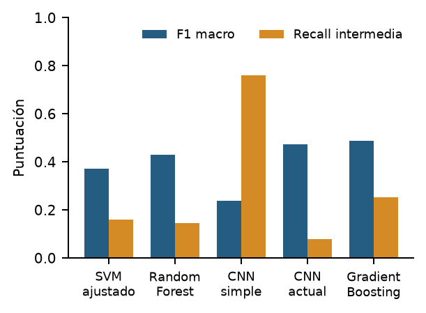
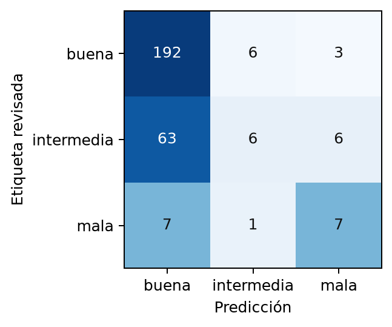

# Clasificación visual y tamaño relativo de manzana roja banano y limón

**Juan Pablo Serrano, Juan Castaño y Felipe Calderon. Algoritmos y Programación III. Semestre 2026-2.**

**Repositorio:** https://github.com/JP11002/proyecto_estado_frutas

**Video:** ENLACE_PENDIENTE

## Resumen

Se desarrolló un prototipo local para clasificar la apariencia externa de manzana roja, banano y limón en buena, intermedia y mala, y medir su tamaño relativo al encuadre. La base única contiene 291 imágenes y máscaras revisadas, con 43 características de color, textura y forma. Se combinaron 21 ejemplos compatibles de Kaggle, 245 fotografías públicas compartidas y 25 propias; el equipo recolectó 51 fotos propias antes de las exclusiones. Se aplicó CRISP-DM, comparación contra una referencia mayoritaria y evaluación externa en tres bloques separados por grupos. SVM ajustado alcanzó F1 macro de 0,373; Random Forest inicial, 0,429; la CNN con MobileNetV3 congelada, 0,472. Un cribado adicional con Gradient Boosting obtuvo 0,487 y recuperó 19 de 75 intermedias, frente a 6 de CNN. La concentración de 67 intermedias en una campaña limita la generalización. La interfaz acepta fotografía o cámara y muestra la calidad estimada y el diámetro equivalente normalizado. Se documentan impactos, decisiones éticas y límites del prototipo.

**Palabras clave:** visión por computador, calidad visual, CNN, clasificación agrupada, tamaño relativo.

## I Introducción

La apariencia de frutas frescas influye en su selección y comercialización. La inspección manual puede variar con el criterio del evaluador y las condiciones de iluminación. La revisión de Bhargava y Bansal [1] organiza la evaluación visual mediante adquisición, preparación, segmentación, extracción de rasgos y clasificación, y considera color, textura, forma, tamaño y defectos. Este proyecto adapta ese flujo a fotografías RGB y recursos computacionales de un curso universitario.

El objetivo es construir y evaluar un apoyo a la inspección de un fruto individual, completo y sobre fondo simple. Se eligieron manzana roja, banano y limón, sustituyendo la naranja del planteamiento inicial por disponibilidad real del equipo. La salida es una de tres calidades visuales y una medida de tamaño en píxeles normalizados. No se determina inocuidad, firmeza interna, patógenos ni vida útil. La aplicación requiere supervisión humana.

El problema combina variaciones de iluminación, forma, resolución, perspectiva y deterioro, además de escasez de ejemplares independientes. Una foto adicional del mismo fruto no equivale a una observación independiente. Por ello, el objetivo técnico incluye comparar modelos, conservar los grupos entre particiones y analizar errores por clase, fruta y fuente, en lugar de optimizar solamente la exactitud global.

## II Fundamentos y formulación matemática

Sea I una imagen RGB de H por W píxeles y M su máscara binaria. Se busca una función f(I,M) que produzca y en {buena, intermedia, mala}, junto con una medida relativa s(M). Para los modelos tradicionales se calcula un vector de 43 características phi(I,M); para CNN se utiliza un recorte RGB de 224 por 224, preservando proporciones y rellenando el fondo con gris neutro.

La normalización de variables tradicionales se realiza dentro del pipeline de SVM: z_j = (x_j - mu_j) / sigma_j. La media y desviación se estiman únicamente en el entrenamiento de cada división. La SVM separa pares de clases maximizando margen con penalización C; se comparan kernel lineal y RBF, K(x,z) = exp(-gamma ||x-z||²). Random Forest agrega la votación de árboles entrenados con aleatoriedad de muestras y características. Estos métodos permiten contrastar fronteras de margen con ensambles no lineales [3].

La CNN de transferencia mantiene fijo el extractor convolucional MobileNetV3 Small preentrenado en ImageNet y añade un clasificador propio [4]. Su salida softmax es p_k = exp(a_k) / sum_j exp(a_j). El cabezal minimiza entropía cruzada ponderada, L = -(sum_i w_yi log p_yi) / sum_i w_yi. Los pesos se calculan solo en entrenamiento: w_c = (N / (3 N_c)) elevado a p, con p en {0, 0,5, 1}. Las puntuaciones softmax no están calibradas como confianza.

El tamaño se mide antes del recorte de CNN. Si A = sum M es el área de la máscara, el diámetro del círculo equivalente es d_eq = 2 sqrt(A/pi). Se reportan s = d_eq / min(H,W) y ocupación q = A/(H W). s es adimensional y puede superar uno para formas alargadas. Cambiar la resolución sin cambiar el encuadre conserva s; cambiar distancia o encuadre altera la medida. No se expresa en centímetros ni se infiere un tamaño físico comercial.

Las métricas se definen por clase: precisión P = TP/(TP+FP), recall R = TP/(TP+FN) y F1 = 2PR/(P+R). F1 macro es el promedio de los tres F1 y da el mismo peso a cada calidad. También se calcula recall macro y exactitud. Para estudiar el predominio de campañas grandes, se recalculan métricas con peso de cada imagen igual a 1/n_g, donde n_g es el número de fotos de su grupo.

## III Metodología aplicada y datos

La Fig. 1 representa CRISP-DM adaptado: se estableció un problema de inspección visual, se auditó la cobertura de las fuentes, se revisaron etiquetas y máscaras, se modeló, se analizaron errores y se implementó el despliegue local. Los errores alimentan una nueva revisión de cobertura o criterios; no autorizan a cambiar etiquetas para favorecer un algoritmo.

**Figura 1.** Flujo personalizado de CRISP-DM y retroalimentación del proyecto. Fuente: elaboración propia.

La base de referencia proviene de Fruit Quality Classification [2]. La ampliación utiliza las dos colecciones de Drive compartidas por el equipo [6]. El inventario incluye 318 fotos nuevas: 267 públicas y 51 propias. Se aceptaron 245 públicas y 25 propias; se excluyeron 26 fotos múltiples y 22 con problemas de segmentación. La base de desarrollo integra esas 270 fotos con 21 ejemplos previos compatibles. Los 22 grupos conservadores incluyen identidades propias confirmadas y campañas cuya independencia física no se conoce.

| Fruta | Buena | Interm. | Mala | Total |
|---|---:|---:|---:|---:|
| Manzana roja | 121 | 3 | 7 | 131 |
| Banano | 8 | 70 | 5 | 83 |
| Limón | 72 | 2 | 3 | 77 |
| Total | 201 | 75 | 15 | 291 |

La clase buena representa 69,1 % de la base. De las 75 intermedias, 70 son bananos y 67 pertenecen a una sola campaña. Por eso, la presencia de las nueve combinaciones fruta/calidad no implica cobertura suficiente para generalizar. Los grupos son unidades de separación conservadora, no un censo de 22 frutos independientes.

Las etiquetas describen apariencia: buena corresponde a superficie mayormente conservada; intermedia, a defectos localizados con superficie conservada; mala, a deterioro externo marcado o extendido. La distinción depende de la fruta y requiere revisión. La anotación actual es operativa, realizada con asistencia de IA y revisión visual, sin medición de acuerdo entre anotadores. Las fotografías se leyeron respetando orientación, se segmentó el fruto y se inspeccionaron máscaras y recortes. Se conservaron los defectos oscuros dentro del contorno para evitar eliminarlos como fondo.

Para EDA y modelos tradicionales se calculan histogramas y estadísticas RGB/HSV, textura de coocurrencia y medidas de circularidad, solidez y aspecto. Las rutas y huellas enlazan imagen, máscara y anotación. Todos los entrenamientos leen data/base/datos.csv; las máscaras y los recortes pertenecen a esa misma base. El tamaño es una medida derivada de la máscara revisada, no una etiqueta ordinal manual de referencia ni un objetivo de regresión con error físico conocido.

## IV Modelado y protocolo de evaluación

Se fijaron tres bloques externos con StratifiedGroupKFold y semilla 42. Los grupos de entrenamiento y evaluación son disjuntos, G_train intersección G_eval = conjunto vacío. Cada imagen recibe una predicción externa por modelo. Dentro del entrenamiento externo se seleccionan hiperparámetros mediante validación agrupada. Las transformaciones aprendidas se ajustan dentro de cada división [3].

El ajuste tradicional comparó 18 configuraciones de SVM y 12 de Random Forest. SVM exploró C de 0,1, 1 y 10, kernel lineal/RBF, pesos normales/balanceados y gamma scale o 0,01 para RBF. Random Forest usó 300 árboles y exploró profundidad sin límite u 8, mínimo de 1, 2 o 4 imágenes por hoja y fracción de características sqrt o 0,7. Se conservaron las referencias iniciales y ajustadas, aun cuando el ajuste empeoró el resultado externo.

Se entrenó una CNN simple desde cero de tres bloques de 16, 32 y 64 canales, pooling y cabezal denso. Su bajo F1 motivó el experimento de transferencia. La CNN actual usa normalización ImageNet, extractor congelado, LayerNorm sin parámetros y cabezal lineal o MLP de 64 unidades. Se probaron seis combinaciones de cabezal y peso de clase con AdamW, tasa 0,003, regularización 0,01 y dropout 0,2. El máximo fue 120 épocas; selección desde 12 y paciencia 15. Las divisiones internas se adaptaron a los grupos disponibles: 3, 2 y 3 en los bloques externos y 3 en selección global, para 66 ajustes internos.

Los aumentos de entrenamiento son espejo horizontal, giros de diez grados y brillo moderado. La evaluación utiliza la vista original. El cache visual aplica un extractor fijo sin aprender estadísticas de la base. El prototipo CNN final seleccionó cabezal lineal y 23 épocas sobre toda la base; sus predicciones de entrenamiento no se utilizan como métrica externa.

El diagnóstico adicional comparó regresión logística y SVM sobre 576 rasgos CNN, y Extra Trees e HistGradientBoosting sobre los 43 rasgos manuales. Los 22 candidatos se fijaron antes de consultar resultados, con 176 ajustes internos y doce externos. La parada temprana automática de Boosting se desactivó para no introducir una división aleatoria de fotos relacionadas. Estas alternativas constituyen un cribado exploratorio; no reemplazan automáticamente el prototipo CNN.

## V Resultados

| Modelo | Exactitud | F1 macro | Recall macro |
|---|---:|---:|---:|
| Mayoritaria | 0,691 | 0,272 | 0,333 |
| SVM inicial | 0,395 | 0,299 | 0,365 |
| SVM ajustado | 0,447 | 0,373 | 0,414 |
| RF inicial | 0,546 | 0,429 | 0,479 |
| RF ajustado | 0,443 | 0,388 | 0,430 |
| CNN simple | 0,271 | 0,237 | 0,393 |
| CNN actual | 0,704 | 0,472 | 0,501 |
| Logística CNN | 0,653 | 0,401 | 0,470 |
| SVM CNN | 0,670 | 0,420 | 0,463 |
| Extra Trees | 0,423 | 0,357 | 0,396 |
| Gradient Boosting | 0,649 | 0,487 | 0,510 |

La CNN actual mejora 0,236 puntos absolutos de F1 macro frente a la CNN simple. La exactitud de la referencia mayoritaria es alta porque siempre predice buena, pero su F1 macro es bajo. Esto confirma la necesidad de interpretar métricas por calidad. El ajuste de hiperparámetros no garantiza una mejora externa: Random Forest ajustado resulta inferior a su referencia inicial.

**Figura 2.** F1 macro y recuperación de la calidad intermedia en predicciones externas agrupadas. Fuente: elaboración propia.

| Calidad | Soporte | Aciertos CNN | Aciertos RF inicial | Aciertos Boosting |
|---|---:|---:|---:|---:|
| Buena | 201 | 192 | 139 | 163 |
| Intermedia | 75 | 6 | 11 | 19 |
| Mala | 15 | 7 | 9 | 7 |

La CNN tiene recall intermedio de 8,0 % y precisión de 46,2 %. Boosting alcanza recall de 25,3 % y precisión de 41,3 %. Detecta más intermedias, pero predice 46 como tales y comete 27 falsas alarmas, frente a 13 predicciones y 7 falsas alarmas de CNN. Su menor exactitud refleja esa compensación. Con peso igual por grupo, F1 macro es 0,531 para CNN y 0,484 para Boosting.

## VI Análisis e interpretación

La CNN confunde 63 intermedias con buenas y seis con malas. En el tercer bloque entrena con solo ocho intermedias, incluidas tres de banano, y evalúa las 67 de una campaña diferente: reconoce tres. Boosting reconoce 17 de esas 67. Los F1 macro externos de CNN son 0,552, 0,547 y 0,266; la diferencia revela inestabilidad ante campañas reservadas. No se demuestra una causa única del error, pero la escasez de variedad independiente y la asociación fruta/calidad son limitaciones comprobadas.

La representación congelada de ImageNet puede capturar identidad o apariencia global del fruto con mayor facilidad que lesiones locales; esta es una hipótesis que requiere comparar representaciones. Las curvas de entrenamiento muestran buen ajuste interno, mientras que el tercer bloque permanece débil. El patrón es compatible con problemas de generalización y cambio de distribución, y no se resuelve mostrando la exactitud sobre las imágenes usadas para entrenar el prototipo final.

**Figura 3.** Matriz de confusión de CNN actual sobre 291 predicciones externas. Filas: etiquetas revisadas. Fuente: elaboración propia.

La revisión [1] describe múltiples condiciones de captura, rasgos y métodos. Este trabajo comparte el uso de apariencia externa y segmentación, pero sus cifras no se comparan directamente con las de otros estudios: no utiliza sus mismas frutas, etiquetas y particiones. La comparación válida en esta entrega es la de los modelos sobre los mismos bloques de la base propia.

Las imágenes ya participaron en la revisión de etiquetas y máscaras, y el diseño evolucionó tras analizar errores previos. Por tanto, las cifras son de desarrollo, incluso con separación agrupada. Se necesita una prueba final de nuevas capturas reservadas antes de ajustar el procesamiento. Las máscaras no tienen referencia independiente píxel a píxel; no se reporta IoU inventado. Tampoco hay medidas físicas de referencia para calcular MAE de tamaño. La estimación en píxeles se verifica geométricamente, no como diámetro real.

## VII Despliegue y reproducibilidad

La aplicación local se inicia con python -m src.main. Permite cargar una foto o recibir fotogramas de cámara, elegir CNN, Random Forest o SVM y mostrar la calidad, el recorte usado por el modelo, el contorno propuesto y el tamaño relativo. La cámara solicita análisis periódicos; un trabajador ejecuta la inferencia para mantener la interfaz disponible. GrabCut propone una máscara para un fruto sobre fondo simple y se muestran alertas geométricas. La propuesta debe revisarse visualmente.

La aplicación reutiliza los pesos guardados y verifica su huella contra la base. Los ejemplos incluidos se identifican como imágenes de entrenamiento y no se presentan como prueba independiente. La captura de cámara no se conserva automáticamente. Se puede exportar el resultado numérico en JSON. El repositorio incluye comandos de instalación, cuadernos ejecutados, pruebas y un verificador de predicciones; los modelos generados se pueden distribuir con el paquete local o regenerar mediante los cuadernos.

## VIII Responsabilidades éticas e impactos

La Tabla siguiente relaciona decisiones con principios del código IEEE [5]. El apoyo de herramientas de IA para código y anotación se reconoce; no se considera evidencia independiente de calidad física. La trazabilidad distingue fuentes públicas y propias y conserva las decisiones de revisión.

| Decisión y riesgo | Principio IEEE | Medida aplicada |
|---|---|---|
| Confundir apariencia con seguridad alimentaria | Bienestar público | Salida de apoyo visual y supervisión humana |
| Fotografiar personas o guardar capturas sin necesidad | Privacidad | Procesamiento local y cámara sin guardado automático |
| Exagerar rendimiento o presentar entrenamiento como prueba | Honestidad | Predicciones agrupadas, referencias y límites explícitos |
| Fallar más en una fruta o calidad | Responsabilidad técnica | Métricas por clase, fruta, fuente y grupo |
| Reutilizar datos y código ajenos | Reconocer contribuciones | Fuentes y asistencia de IA documentadas |

En la etapa inicial se identificaron beneficios potenciales y riesgos. Tras la evaluación, el impacto se revisa con evidencia: la clase intermedia sigue siendo débil y no se justifica automatizar decisiones de descarte. No se midieron ahorros económicos, reducción de residuos ni consumo energético, por lo que no se afirman mejoras realizadas en esas magnitudes.

| Dimensión | Beneficio potencial y riesgo | Mitigación y conclusión final |
|---|---|---|
| Social | Apoyo a inspección; errores y confianza excesiva | Revisión humana y comunicación de limitaciones |
| Económica | Estandarización; costes de errores y mantenimiento | Piloto antes de uso comercial y registro de errores |
| Ambiental | Aprovechamiento de alimentos; energía y descarte equivocado | CPU disponible, ejecución bajo demanda y sin descarte automático |
| Global | Adaptación a otros mercados; cambios de variedades e iluminación | Evaluación local por fruta y protocolo de captura |

## IX Conclusiones y trabajo futuro

Se implementó un flujo completo de adquisición, revisión, preparación, modelado, evaluación e inferencia local con una sola base. La CNN de transferencia mejora la CNN simple y alcanza la mayor exactitud; Boosting ofrece una recuperación intermedia superior con menor exactitud. La elección depende del coste de errores y no de un único promedio. Los resultados conectan el modelo matemático, la separación por grupos y las restricciones reales de los datos.

Con la base actual, las prioridades son revisar criterios fronterizos por fruta, probar fusión de rasgos manuales y CNN, seleccionar costes y umbrales dentro de la validación interna y estudiar ajuste parcial del último bloque convolucional. Aumentos o sobremuestreo no crean campañas independientes. Una siguiente validación debe incluir nuevas capturas reservadas y referencia manual de tamaño si se pretende evaluar medidas físicas.

## Referencias

[1] A. Bhargava y A. Bansal, “Fruits and vegetables quality evaluation using computer vision: A review,” Journal of King Saud University Computer and Information Sciences, vol. 33, pp. 243-257, 2021, doi: 10.1016/j.jksuci.2018.06.002.

[2] ryandpark, “Fruit Quality Classification,” Kaggle, conjunto de datos. Disponible: https://www.kaggle.com/datasets/ryandpark/fruit-quality-classification. Consulta: 26 de noviembre de 2026.

[3] scikit-learn developers, “User Guide” y “Cross-validation: evaluating estimator performance,” documentación 1.9. Disponible: https://scikit-learn.org/stable/modules/cross_validation.html. Consulta: 26 de noviembre de 2026.

[4] PyTorch contributors, “Transfer Learning for Computer Vision Tutorial” y “MobileNetV3 Small,” documentación oficial. Disponible: https://docs.pytorch.org/tutorials/beginner/transfer_learning_tutorial. Consulta: 26 de noviembre de 2026.

[5] IEEE, “IEEE Code of Ethics,” IEEE Circuits and Systems Society. Disponible: https://ieee-cas.org/about/ieee-code-ethics. Consulta: 26 de noviembre de 2026.

[6] Equipo del proyecto, “Colecciones compartidas pública y propia de imágenes de frutas,” Google Drive, noviembre de 2026. Identificadores: 12Wcfr_mRLxJ98EpHR9WwbMd7jp49kZxK y 1AyydHBltsfnj9YC4-F9xi9AeogtiK6Fx. Inventario y trazabilidad en data/annotations/drive_20261124/.

[7] T. Kassis, V. Agarwal, Y. He, D. Patel y A. M. Brueckner, “Scientific Agent Skills: A Library of Procedural Knowledge for Research Agents,” 2026, doi: 10.48550/arXiv.2609.00065. Apoyo metodológico para el análisis con scikit-learn.
