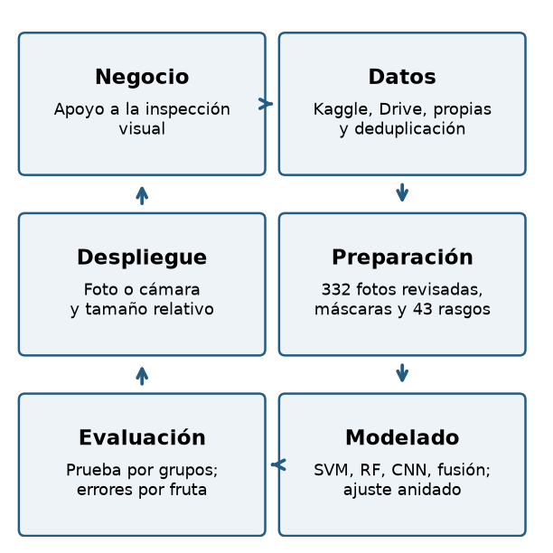
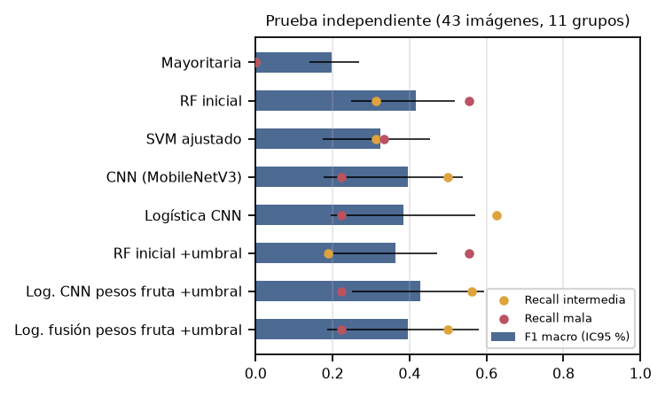
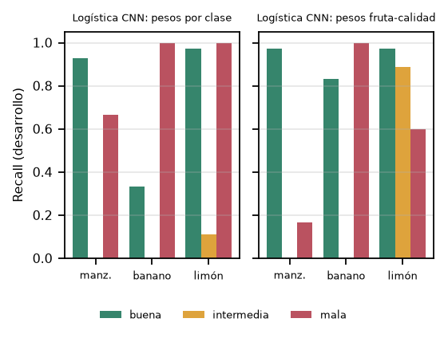
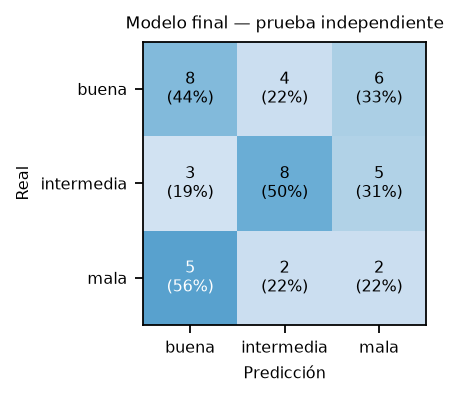

# Clasificación visual y tamaño relativo de manzana roja banano y limón

**Juan Pablo Serrano, Juan Castaño y Felipe Calderon. Algoritmos y Programación III. Semestre 2026-2.**

**Repositorio:** https://github.com/JP11002/proyecto_estado_frutas

**Video:** ENLACE_PENDIENTE

## Resumen

Se desarrolló un prototipo que clasifica la apariencia externa de manzana roja, banano y limón en buena, intermedia y mala, y mide su tamaño relativo al encuadre. La base contiene 332 imágenes revisadas de Kaggle, de colecciones compartidas y propias, con máscaras y 43 características de color, textura y forma. Siguiendo CRISP-DM se reservó una prueba independiente por grupos (43 imágenes, 11 grupos) antes de entrenar, y se seleccionaron modelos con validación cruzada agrupada y anidada. Se compararon SVM, Random Forest, regresión logística, Gradient Boosting y clasificadores sobre MobileNetV3 congelada. El diagnóstico reveló un atajo: el modelo aprendía la fruta en lugar del defecto. Ponderar cada combinación fruta-calidad lo corrigió en limón (F1 de 0,59 a 0,83 en desarrollo, con el mismo modelo). El modelo final, que fusiona rasgos manuales y profundos, obtuvo F1 macro 0,572 en desarrollo y 0,395 en la prueba (IC95 % 0,19–0,58), frente a 0,197 de la referencia mayoritaria. Una validación anidada sobre las 332 imágenes con tres semillas dio 0,46 ± 0,07 para ese modelo y 0,58 ± 0,10 para el cabezal sobre la CNN: la selección no es estable y las diferencias entre modelos no son significativas. La interfaz acepta foto o cámara y requiere supervisión humana.

**Palabras clave:** visión por computador, calidad visual, validación agrupada, aprendizaje por atajos, transferencia.

## I Introducción

La apariencia de frutas frescas influye en su comercialización, y la inspección manual varía con el evaluador y la iluminación. La revisión de Bhargava y Bansal [1] organiza la evaluación visual en adquisición, segmentación, extracción de rasgos y clasificación por color, textura, forma, tamaño y defectos. Este proyecto adapta ese flujo a fotografías RGB y a recursos de CPU.

El objetivo es apoyar la inspección de un fruto individual sobre fondo simple: asignar una de tres calidades visuales y estimar su tamaño en píxeles normalizados. No se determina inocuidad, estado interno ni vida útil. Limón sustituye a la naranja del planteamiento inicial por disponibilidad del equipo.

Es un problema complejo de ingeniería por cinco razones: pocos ejemplares independientes, con varias fotos del mismo fruto o campaña; desbalance (63 % de buenas); asociación entre fruta y calidad en los datos; cambios de dominio entre fuentes (resolución, fondo, iluminación); y criterios de calidad que dependen de la fruta. Por ello el objetivo técnico no es maximizar la exactitud, sino estimar honestamente la generalización y analizar los errores por clase, fruta y fuente.

## II Fundamentos y formulación matemática

**Datos y objetivo.** Sea D = {(I_i, M_i, y_i, f_i, g_i)}, con imagen RGB I, máscara M, calidad y ∈ {buena, intermedia, mala}, fruta f y grupo g (fruto, sesión o campaña). Se busca h tal que ŷ = h(I, M) generalice a grupos no vistos. La partición cumple G_dev ∩ G_test = ∅: fotos de un mismo grupo nunca quedan a ambos lados, porque comparten fruto, fondo e iluminación y su separación aleatoria filtra información [7], [9].

**Representaciones.** φ(I,M) ∈ R^43 contiene medias, desviaciones e histogramas RGB/HSV dentro de la máscara (el tono se representa con seno y coseno por ser angular), textura de coocurrencia y circularidad, solidez y aspecto. ψ(I) ∈ R^576 es la salida de la última capa convolucional de MobileNetV3 Small preentrenada en ImageNet y congelada [5], sobre la fotografía completa a 224×224 con proporción conservada. La fusión es z = [φ; ψ]. Toda normalización z_j = (x_j − μ_j)/σ_j estima μ y σ solo con el entrenamiento de cada división.

**Clasificador final.** Regresión logística multinomial, p_k(z) = exp(w_kᵀz) / Σ_j exp(w_jᵀz), que minimiza

L(W) = Σ_i ω_i [−log p_{y_i}(z_i)] + (1/2C)‖W‖².

Es equivalente a un cabezal softmax lineal sobre la red congelada. Con ω_i = N/(3 N_{y_i}) se equilibran las clases. Con ω_i = N/(K·n_{f_i,y_i}), donde n_{f,y} es el tamaño de la celda fruta-calidad y K el número de celdas, cada combinación pesa igual: si una fruta casi siempre tiene la misma calidad, predecir la fruta deja de reducir la pérdida.

**Regla de decisión con costes.** ŷ = argmax_k a_k p_k(z), con a = (1, a_2, a_3) y a_2, a_3 ∈ [0,25; 8] elegidos sobre predicciones internas para maximizar F1 macro. Es la decisión de Bayes con costes por clase [10].

**Métricas.** P_k = TP_k/(TP_k+FP_k), R_k = TP_k/(TP_k+FN_k), F1_k = 2P_kR_k/(P_k+R_k). F1 macro = (1/3) Σ_k F1_k da el mismo peso a cada calidad; F1 ponderado pesa por soporte. Los IC95 % se obtienen remuestreando grupos completos 2000 veces [11].

**Tamaño.** Con A = Σ M, el diámetro equivalente es d = 2√(A/π) y s = d/min(H,W). Es adimensional y depende de la distancia y del encuadre; no expresa centímetros.

## III Metodología y datos

La Fig. 1 resume CRISP-DM aplicado. El diagnóstico de errores realimenta la revisión de datos y criterios; nunca autoriza cambiar etiquetas para favorecer un modelo.

**Figura 1.** Flujo personalizado de CRISP-DM y retroalimentación del proyecto. Fuente: elaboración propia.

**Fuentes.** Fruit Quality Classification [2] es una copia de FruitNet [3]. Se suman colecciones compartidas de la clase [6] y fotos propias. El equipo recolectó 51 fotos; entraron 25. El 26/11 aparecieron 2 101 archivos nuevos en las carpetas propias, etiquetados como intermedios. El análisis por píxeles encontró 541 duplicados exactos, 1 381 variantes aumentadas de un mismo original (rotaciones, rellenos, cambios de color), 18 fotos de stock y 62 vistas de una sola manzana. Incorporar variantes habría repartido copias de una foto entre entrenamiento y evaluación. Se revisaron los 99 originales: 48 tenían menos de 64 px de lado y 10 eran incompletos, ambiguos o fuera de alcance; se incluyeron 41, y la revisión cambió la etiqueta declarada en 22.

| Fruta | Buena | Interm. | Mala | Total |
|---|---:|---:|---:|---:|
| Manzana roja | 123 | 6 | 7 | 136 |
| Banano | 10 | 77 | 14 | 101 |
| Limón | 76 | 11 | 8 | 95 |
| Total | 209 | 94 | 29 | 332 |

Las etiquetas describen apariencia: buena (superficie conservada), intermedia (defectos localizados, menos de un tercio) y mala (deterioro marcado o extendido). Las asignó un revisor asistido por IA, sin medir acuerdo entre anotadores. Tres campañas reúnen 245 fotos, y 67 de las 94 intermedias son una misma campaña de banano.

**Protocolo.** (1) Prueba: entre StratifiedGroupKFold de 4, 5 y 6 bloques (semilla 42), el bloque con las tres calidades, sin campañas mayores al 10 % de la base y con más grupos. Resultado: 43 imágenes de 11 grupos (18, 16 y 9 por clase), congeladas antes de entrenar. (2) Desarrollo (289 imágenes, 20 grupos): validación externa agrupada de 5 bloques con búsqueda interna agrupada (anidada [8]). (3) El modelo final se eligió por F1 macro de desarrollo antes de predecir la prueba. (4) Cada modelo se entrenó con y sin el lote nuevo, evaluando las mismas filas, para aislar el efecto de los datos. (5) Como complemento, validación anidada y agrupada de 5 bloques sobre las 332 imágenes, repetida con las semillas 42, 7 y 2026; no se usó para elegir el modelo.

**Modelos.** SVM (lineal/RBF) y Random Forest con las rejillas del proyecto; regresión logística; HistGradientBoosting sin parada temprana aleatoria (mezclaría grupos); cabezal propio lineal o MLP sobre MobileNetV3, entrenado con AdamW y aumentos solo en entrenamiento; logística sobre ψ y sobre la fusión. Todos usan pesos de clase y tienen variantes con pesos fruta-calidad y con la regla de costes. No se usa sobremuestreo: duplicar fotos de pocas campañas no añade variabilidad independiente. La justificación de cada decisión (D1–D15) está en docs/ajuste_y_cnn.md.

## IV Resultados

| Modelo | F1 dev | F1 prueba (IC95 %) | R int. | R mala |
|---|---:|---:|---:|---:|
| Mayoritaria | 0,265 | 0,197 | 0,00 | 0,00 |
| RF inicial | 0,291 | 0,417 (0,25–0,52) | 0,31 | 0,56 |
| SVM ajustado | 0,420 | 0,324 (0,18–0,45) | 0,31 | 0,33 |
| CNN cabezal MLP | 0,480 | 0,397 (0,18–0,54) | 0,50 | 0,22 |
| Logística CNN | 0,483 | 0,385 (0,20–0,57) | 0,63 | 0,22 |
| Log. CNN pesos fruta + costes | 0,542 | 0,428 (0,25–0,59) | 0,56 | 0,22 |
| **Final: fusión pesos fruta + costes** | **0,572** | **0,395 (0,19–0,58)** | 0,50 | 0,22 |

R: recall en prueba. El modelo final obtuvo en prueba 41,9 % de exactitud y F1 ponderado 0,434. En desarrollo alcanzó 73,4 % de exactitud, recall de mala 0,75 y de intermedia 0,12.

**Figura 2.** Prueba independiente: F1 macro con IC95 % por grupos y recall de intermedia y mala. Fuente: elaboración propia.

**Efecto de los datos nuevos (desarrollo, mismas filas).** Mejoraron los modelos con rasgos CNN: logística CNN de 0,421 a 0,483 y fusión de 0,432 a 0,558. Empeoraron los de rasgos manuales: RF inicial de 0,518 a 0,291 y HistGB de 0,440 a 0,326. En la prueba, las variaciones (por ejemplo, fusión con pesos fruta de 0,466 a 0,436) quedan dentro de la incertidumbre.

**Validación anidada sobre las 332 imágenes** (media ± desviación entre 3 semillas):

| Modelo | F1 macro | R int. | R mala |
|---|---:|---:|---:|
| Mayoritaria | 0,258 | 0,00 | 0,00 |
| RF inicial | 0,396 ± 0,034 | 0,20 | 0,51 |
| SVM ajustado | 0,330 ± 0,053 | 0,23 | 0,25 |
| CNN cabezal + costes | 0,575 ± 0,097 | 0,38 | 0,59 |
| Logística CNN + costes | 0,508 ± 0,018 | 0,20 | 0,51 |
| Log. CNN pesos fruta | 0,450 ± 0,013 | 0,21 | 0,61 |
| Final: fusión pesos fruta + costes | 0,460 ± 0,065 | 0,19 | 0,54 |

**Figura 3.** Recall por fruta en desarrollo de la logística sobre la CNN: pesos por clase frente a pesos por combinación fruta-calidad. Fuente: elaboración propia.

**Figura 4.** Matriz de confusión del modelo final en la prueba independiente. Filas: etiqueta revisada. Fuente: elaboración propia.

## V Análisis e interpretación

**Atajo por fruta.** Con el protocolo anterior de 3 bloques, la CNN alcanzó F1 macro 0,660 y 80,7 % de exactitud. Pero clasificó como intermedios 9 de 10 bananos buenos y no acertó ninguno de los 11 limones intermedios: había aprendido "banano = intermedia" y "limón = buena", porque 77 de 101 bananos son intermedios. Es aprendizaje por atajos [12]: una métrica global alta con una regla inútil. Los pesos fruta-calidad lo corrigen donde hay ejemplos: con la misma logística sobre la CNN, en limón el recall de intermedia pasa de 0,11 a 0,89 y el F1 de 0,59 a 0,83 (Fig. 3). En banano no hay mejora posible en desarrollo: cuando la campaña de 67 intermedias se valida, el entrenamiento no tiene suficientes bananos intermedios.

**Generalización y sobreajuste.** En los modelos con rasgos CNN, el F1 de la validación interna (0,46–0,58) es parecido al del desarrollo externo (0,48–0,57): la selección anidada no sobreajustó los hiperparámetros [8]. La caída aparece en la prueba (0,39–0,44), cuyas fuentes (recortes del lote, Kaggle y fotos propias) difieren del desarrollo, dominado por campañas públicas. Es un problema de generalización entre dominios más que de memorización. Los IC95 % de la prueba (±0,2) se solapan: con 11 grupos no puede afirmarse que un modelo supere a otro. Todos los modelos útiles superan a la referencia mayoritaria.

**Estabilidad de la selección.** En la validación anidada el cabezal sobre la CNN obtiene la media más alta (0,575), pero también la mayor variación: entre 0,51 y 0,69 según dónde caigan las campañas grandes. El modelo final elegido en desarrollo queda en 0,460. El orden entre modelos depende de la partición, de modo que la elección del modelo es un resultado incierto. No se cambió el modelo final, porque esa validación incluye las imágenes de prueba; con más grupos independientes, la elección entre cabezal CNN y fusión debe repetirse. Los pesos fruta-calidad muestran un compromiso: con la logística sobre la CNN reducen el atajo (recall de bananos buenos de 0,07 a 0,43; de limones intermedios, de 0,18 a 0,52), pero bajan el F1 macro global de 0,472 a 0,450, porque las campañas grandes dejan de favorecer la predicción por fruta.

**Regla de costes.** Los pesos elegidos para el modelo final, a = (1; 0,25; 0,5), favorecen "buena" porque el desarrollo está dominado por campañas buenas. Subieron el F1 de desarrollo de 0,512 a 0,572, pero en la prueba (42 % de buenas) bajaron el recall de mala de 0,33 a 0,22. Es un cambio de distribución a priori. No se cambió la selección después de ver la prueba, para no invalidarla.

**Fuentes y dominio.** Los rasgos manuales calculados sobre recortes pequeños y borrosos difieren de los de fotos completas. Al añadir el lote, RF predijo "mala" en casi todas las buenas de las campañas públicas (exactitud 0,04 en esa fuente). Los rasgos de la CNN son más robustos a ese cambio. En la prueba, el modelo final acierta las buenas de las fotos propias (5/5) pero ninguna de sus 6 defectuosas, y 5 de las 9 malas de la prueba se predicen buenas. Por eso no debe descartar ni aprobar fruta de forma autónoma.

**Comparación con la literatura.** Morshed et al. [4] reportan 99,67 % de exactitud en FruitNet con DenseNet201, usando una división aleatoria 60:20:20 sin agrupar fotos del mismo fruto. FruitNet contiene secuencias del mismo fruto, de modo que esa división mide sobre todo memorización de capturas. Nuestras cifras miden la generalización a grupos no vistos, en tres frutas con una clase intermedia y fuentes heterogéneas, y no son comparables con esa cifra.

## VI Despliegue

La aplicación (python -m src.main) carga una foto o recibe fotogramas de cámara y ofrece CNN, Random Forest, SVM y el modelo final. Muestra la calidad, las puntuaciones, la variante de decisión y el tamaño relativo. GrabCut propone la máscara y se emiten alertas geométricas; si la segmentación falla, solo pueden usarse los modelos sin rasgos manuales. Los modelos se entrenaron solo con desarrollo, así que las métricas de prueba corresponden a los pesos desplegados. El motor reproduce las 43 predicciones de prueba de cada modelo. En CPU, clasificar tarda unos 0,03 s y el análisis completo de una foto de 12 MP (segmentación, rasgos y red), unos 3,3 s. La cámara no guarda capturas.

## VII Responsabilidades éticas e impactos

La tabla relaciona decisiones con el Código de Ética del IEEE [13] y la Ley 842 de 2003 [14]. El análisis completo está en docs/etica.md.

| Decisión y riesgo | Principio | Medida aplicada |
|---|---|---|
| Confundir apariencia con inocuidad | Bienestar público | Salida de apoyo; supervisión humana |
| Capturar personas o guardar fotos | Privacidad | Proceso local; cámara sin guardado |
| Fotos aportadas por otros a la colección del curso | Consentimiento y reconocimiento | Uso académico acordado en el curso; solo frutos; procedencia citada |
| Fotos de terceros (stock con marca de agua) | Propiedad intelectual | Excluidas; inventario con motivo |
| Etiquetas de un revisor asistido por IA | Honestidad | Criterios e historial publicados; limitación declarada |
| Atajo por fruta: falla en frutas con defectos | Equidad técnica | Métricas por fruta; pesos fruta-calidad |
| Presentar entrenamiento como prueba | Honestidad | Prueba por grupos congelada; IC95 % |

| Dimensión | Riesgo identificado | Mitigación |
|---|---|---|
| Social | 5 de 9 malas pasan como buenas en la prueba | Revisión humana obligatoria |
| Social | Cámara en puntos de venta: percepción de vigilancia | Encuadre solo de la fruta; proceso local, sin red ni guardado |
| Económica | 10 de 18 buenas marcadas defectuosas: posible desperdicio | Piloto con registro de costes antes de uso comercial |
| Ambiental | Inferencia en CPU (0,03 s por clasificación) | Sin GPU; ejecución bajo demanda |
| Global | Variedades, fondos y luz cambian el desempeño | Validación local por fruta y protocolo de captura |

## VIII Conclusiones y trabajo futuro

Se construyó un flujo completo y reproducible de adquisición, revisión, modelado, evaluación y despliegue, con una prueba independiente por grupos. La formulación con grupos disjuntos, pesos por celda fruta-calidad y regla de costes permitió detectar y corregir parcialmente un atajo que inflaba las métricas. El modelo final generaliza por encima de la referencia (F1 macro 0,395 frente a 0,197 en la prueba; 0,46 ± 0,07 en validación anidada), pero lejos de un uso autónomo. Las diferencias con otros modelos no son significativas y su orden cambia con la partición: el cabezal sobre la CNN obtuvo la mejor media anidada (0,58 ± 0,10). La conclusión técnica es que el límite actual son los datos, no el algoritmo: faltan limones y manzanas intermedios y malos, bananos buenos y grupos independientes. El trabajo futuro, en orden de impacto, es: (1) capturar esas combinaciones en sesiones distintas con un protocolo de fondo e iluminación; (2) medir el acuerdo entre anotadores (κ de Cohen) en una muestra; (3) ajustar la regla de costes con la distribución esperada de uso; (4) evaluar el ajuste fino del último bloque convolucional cuando haya más datos; y (5) añadir una referencia física para medir el tamaño en centímetros.

## Referencias

[1] A. Bhargava y A. Bansal, “Fruits and vegetables quality evaluation using computer vision: A review,” Journal of King Saud University Computer and Information Sciences, vol. 33, pp. 243-257, 2021, doi: 10.1016/j.jksuci.2018.06.002.

[2] ryandpark, “Fruit Quality Classification,” Kaggle, conjunto de datos. Disponible: https://www.kaggle.com/datasets/ryandpark/fruit-quality-classification. Consulta: 26 de noviembre de 2026.

[3] V. Meshram y K. Patil, “FruitNet: Indian fruits image dataset with quality for machine learning applications,” Data in Brief, vol. 40, art. 107686, 2022, doi: 10.1016/j.dib.2021.107686.

[4] M. S. Morshed, S. Ahmed, T. Ahmed, M. U. Islam y A. B. M. A. Rahman, “Fruit quality assessment with densely connected convolutional neural network,” en Proc. 12th Int. Conf. Electrical and Computer Engineering (ICECE), 2022; arXiv:2212.04255.

[5] A. Howard et al., “Searching for MobileNetV3,” en Proc. IEEE/CVF Int. Conf. Computer Vision (ICCV), 2019, pp. 1314-1324, doi: 10.1109/ICCV.2019.00140.

[6] Equipo del proyecto, “Colecciones compartidas pública y propia de imágenes de frutas,” Google Drive, noviembre de 2026. Identificadores: 12Wcfr_mRLxJ98EpHR9WwbMd7jp49kZxK y 1AyydHBltsfnj9YC4-F9xi9AeogtiK6Fx. Trazabilidad en data/annotations/.

[7] D. R. Roberts et al., “Cross-validation strategies for data with temporal, spatial, hierarchical, or phylogenetic structure,” Ecography, vol. 40, no. 8, pp. 913-929, 2017, doi: 10.1111/ecog.02881.

[8] S. Varma y R. Simon, “Bias in error estimation when using cross-validation for model selection,” BMC Bioinformatics, vol. 7, art. 91, 2006, doi: 10.1186/1471-2105-7-91.

[9] S. Kaufman, S. Rosset, C. Perlich y O. Stitelman, “Leakage in data mining: Formulation, detection, and avoidance,” ACM Trans. Knowledge Discovery from Data, vol. 6, no. 4, art. 15, 2012, doi: 10.1145/2382577.2382579.

[10] C. Elkan, “The foundations of cost-sensitive learning,” en Proc. 17th Int. Joint Conf. Artificial Intelligence (IJCAI), 2001, pp. 973-978.

[11] B. Efron y R. J. Tibshirani, An Introduction to the Bootstrap. Nueva York: Chapman & Hall, 1993.

[12] R. Geirhos et al., “Shortcut learning in deep neural networks,” Nature Machine Intelligence, vol. 2, pp. 665-673, 2020, doi: 10.1038/s42256-020-00257-z.

[13] IEEE, “IEEE Code of Ethics,” IEEE Policies, sec. 7.8. Disponible: https://www.ieee.org/about/corporate/governance/p7-8. Consulta: 26 de noviembre de 2026.

[14] Congreso de Colombia, “Ley 842 de 2003, por la cual se adopta el Código de Ética Profesional de la ingeniería,” Diario Oficial No. 45.340, 14 de octubre de 2003.

[15] F. Pedregosa et al., “Scikit-learn: Machine learning in Python,” Journal of Machine Learning Research, vol. 12, pp. 2825-2830, 2011.
